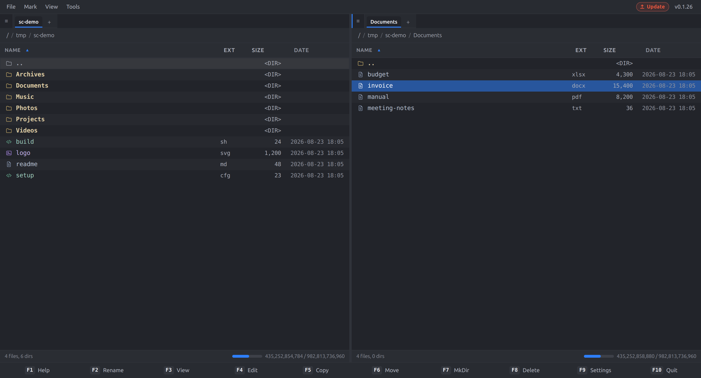

# Something Commander

A modern orthodox two-panel file manager for people who already know how to use one.

Built with Electron, React, and TypeScript. Cross-platform: **Linux** (AppImage, deb), **macOS** (zip, x64/arm64), **Windows** (NSIS).

[](https://github.com/nowherenone/something-commander/actions/workflows/build.yml)



If your formative years involved Norton Commander, DOS Navigator, FAR, or Total Commander — your muscle memory already works here. Two panels, a cursor, Insert to tag, F5 to copy, F6 to move, Alt+F1/F2 for the drive menus. The mouse is optional. It has always been optional.

## Download

Grab the latest build from the [Releases](https://github.com/nowherenone/something-commander/releases) page. The app self-updates from there — when a new release ships, the badge in the title bar tells you and one click applies it.

## The keyboard

Selection and navigation work the way they always have: **Tab** swaps panels, **Insert** or **Space** tags files, **Backspace** goes up, **Enter** descends. The classics are all there:

| Chord | Command | Chord | Command |
|------------------|--------------------|--------------------|--------------------|
| `Alt+F1` / `Alt+F2` | Drive menu (left / right) | `Ctrl+H` | Show hidden files |
| `Alt+F5` | Pack | `Ctrl+R` | Reread directory |
| `Alt+F7` | Search | `Ctrl+M` | Multi-rename tool |
| `Alt+F9` | Unpack | `Ctrl+Q` | Quick view panel |
| `Ctrl+A` | Select all | `Ctrl+1/2/3` | Brief / tree / info view |
| `Ctrl+I` | Invert selection | `Ctrl+Shift+C` | Compare directories |
| `Ctrl+T` / `Ctrl+W` | New / close tab | `Ctrl+L` | Focus address bar |
| `Ctrl+D` | Drive menu | `Ctrl+C` | Copy selected names |
| `Ctrl+E` | Focus command line | `Alt+F8` / `Ctrl+↓` | Command history |
| `Ctrl+Enter` | Paste cursor name into command line | `Ctrl+Shift+Enter` | Paste cursor full path |
| `Ctrl+P` | Paste current directory | `Shift+Enter` (in command line) | Run detached (GUI apps) |
| `Tab` (in command line) | Complete path / command / history | `Ctrl+R` (in command line) | Fuzzy-search history |
| `Ctrl+C` (in command line, while running) | Stop the running command | | |

Every binding is remappable in **F9 → Keybindings**, if your fingers disagree with our defaults.

### Two deliberate departures

- **Ctrl+C copies the selected file names**, not "compare directories". It's the entrenched clipboard convention; compare lives on `Ctrl+Shift+C`.
- **F2 renames** (Total Commander habit). `Ctrl+Enter` used to rename too; it now pastes the cursor name into the command line, as in Total Commander. Saved keybindings are migrated automatically — rebind it in your keybindings if you want the old behavior back.

### The command line

The bar at the bottom runs commands in the active panel's directory. It's on by default (toggle it from **View → Command Line**).

- **Just start typing.** Any printable key in the panel (no Ctrl/Alt) goes to the command line. `Ctrl+E` focuses it explicitly.
- **Paste helpers:** `Ctrl+Enter` inserts the name under the cursor, `Ctrl+Shift+Enter` its full path, `Ctrl+P` the current directory — quoted for your shell (bash/zsh, PowerShell, or cmd).
- **Built-ins that drive the panel:** `cd` (`..`, `~`, `-`, absolute or relative, `D:` on Windows — also inside SFTP/S3/archives where it makes sense), `mkdir <name>`, and `j <bookmark>` to jump to a bookmark by name. Prefix a line with `!` to send it straight to the shell instead.
- **Type a file's name** (a non-executable file in the current folder) and press Enter to open it with its associated app.
- **Your real shell.** By default commands run in `$SHELL` (falling back to `/bin/sh`); on macOS the login environment (`$SHELL -ilc env`) is captured once at startup so Homebrew/nvm/pyenv PATHs work even when the app was launched from the Dock. On Windows it prefers `pwsh`, then Windows PowerShell, with UTF-8 output forced. **F9 → General → Shell** still overrides it (e.g. `cmd`, `zsh`, `/usr/bin/fish`); leave it empty for auto. Settings that held the old defaults (`/bin/bash`, `powershell`) are migrated to auto.
- **Streaming output.** `Enter` runs the command and streams stdout/stderr into a docked, resizable pane (drag its top edge) — no time limit, ANSI colors rendered, stderr tinted, very long output keeps the last lines. **Stop** in the pane header, or `Ctrl+C` in the command line with no text selected, kills the whole process tree. Commands get no stdin, so interactive programs (`vim`, `top`, password prompts) won't work — use a terminal for those. Non-zero exits, kills and spawn errors show in the pane header.
- `Shift+Enter` starts the command detached for GUI apps.
- **Tab completion:** file and folder names (relative, absolute or `~/`, quoted if needed), commands on your `PATH` (and `PATHEXT` on Windows) for the first word, and matching history. One match is inserted; several extend the common prefix and open a list (`↑`/`↓`, `Tab`/`Enter` to accept).
- **`Ctrl+R`** opens a fuzzy history search; type a few letters, `Enter` picks, `Ctrl+R`/`↓` cycles, `Esc` cancels.
- **Placeholders** (whole words only, shell-quoted): `%f` the name under the cursor, `%F` or `%s` the full paths of the selection (or the cursor file), `%p` the active panel's directory, `%P` the other panel's. A ghost line under the bar previews the expanded command. Write `%%f` for a literal `%f`.
- **Each:** toggle the **Each** button to run the command once per selected file (sequentially, with progress in the pane header). `%f`/`%F` then refer to that one file; without placeholders the file name is appended.
- **History** is kept across restarts (last 500, no duplicates): `↑`/`↓` walk it, `Ctrl+↓` or `Alt+F8` opens the list (`Shift+Del` removes an entry).
- Shell commands only run in local folders; on SFTP/S3/SMB/archive panels the bar says so, and `cd`/`j`/`mkdir` still work.

## What it does

- **Real file operations with a queue.** Copy/move/delete run through an operation pipeline with progress, cancellation, and a minimized-operations tray — big jobs don't freeze the panels.
- **Archives as folders.** Browse into zip, 7z, tar, rar and friends; pack with `Alt+F5`, extract with `Alt+F9`.
- **Network filesystems as plugins.** SFTP, SMB, and S3 buckets mount into the same two panels — copy from a bucket to an SSH box with F5 like it's two floppies.
- **Compare directories** (`Ctrl+Shift+C`), asymmetric-copy aware, with color-coded newer/older/orphan files.
- **Multi-rename tool** (`Ctrl+M`) for the "rename 300 photos" evening.
- **F3 view / F4 edit** with a built-in viewer and editor.
- **Quick view** (`Ctrl+Q`) previews the cursor's file without leaving the list.
- **Command line** at the bottom of the panel — runs in the active panel's directory, with streaming colored output, Tab completion, `Ctrl+R` history search, `%f`-style placeholders, persistent history, `cd`/`j` built-ins and Total Commander paste keys. Your shell, your PATH. See [The command line](#the-command-line).
- **Four themes**, including a **Classic** skin — the blue-and-yellow you're nostalgic for is one settings click away. Font, font size, and row height are configurable too, because 24px rows at 13px mono is a feature, not a bug.

## Building from source

```bash
npm install
npm run dev        # Electron + hot reload
```

### Testing

**Always run the full suite before claiming a file-ops or dialog fix works, and before every release.**

| Command | Purpose |
|---------|---------|
| `npm test` | Unit tests (vitest) — fast |
| `npm run test:visual` | Playwright visual / dialog UI tests |
| `npm run test:all` | Unit **+** visual — **required gate** |
| `npm run test:e2e:update` | Refresh screenshots after intentional UI changes |
| `npm run test:e2e:electron` | Builds, then drives the real Electron app (command-line keyboard/focus). Headless Linux: `xvfb-run -a npm run test:e2e:electron` |
| `npm run pre-release` | typecheck + `test:all` + production build |

- **Unit**: includes real zip→disk stream progress and cancel tests under `src/__tests__/`.
- **Visual**: Playwright opens the harness at `/#/test-harness` (no Electron). Covers operation dialog states and a live zip-progress stepper.

### Releasing

```bash
npm run pre-release    # must be green
# bump package.json version, commit
git tag vX.Y.Z
git push origin vX.Y.Z   # triggers GitHub Actions build + release
```

See **[RELEASE.md](./RELEASE.md)** for the full checklist (version bump, manual smoke, packaging, auto-update).

## License

[MIT](./LICENSE)
